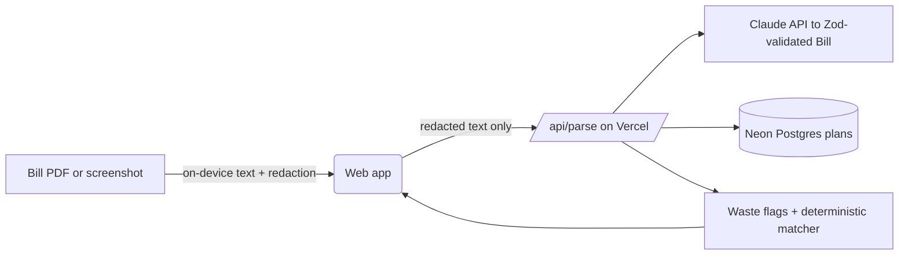

# Fineprint

Upload a phone bill. See every charge in plain English, get warned about waste, and find a cheaper Canadian plan.

**Live:** https://fineprint-flame.vercel.app

## How it works
1. Your bill (PDF, screenshot or text) is read **on your device** with pdf.js / Tesseract.
2. Account numbers, phone numbers, emails and postal codes are masked before anything is sent.
3. Claude extracts every line item into a Zod-validated schema, retrying once with the validation error, then falling back to manual entry.
4. Waste flags (expiring promos, low usage, overages) and plan matching run as deterministic code against a hand-verified table of Canadian plans. Ranking plans is math, not a job for an LLM.
5. Nothing is stored except anonymous counts.

## Architecture


## AI evals
A 50-bill synthetic eval suite (`packages/core/evals`) scores extraction field by field. Claude Haiku and Sonnet both scored 100% on it, so Haiku is the default (cheaper and faster). A harder set with OCR noise and messier layouts is next.

## Stack
TypeScript · Next.js · Tailwind + shadcn/ui · PostgreSQL (Neon) · Claude API · Zod · Turborepo + pnpm · Vercel

## Run locally
```
pnpm install
# add DATABASE_URL and ANTHROPIC_API_KEY to apps/web/.env.local
pnpm --filter web dev
```

## Roadmap
- [ ] Unit + E2E tests, CI
- [ ] iOS/Android app (Expo) sharing the same core
- [ ] Ask-about-my-bill chat
- [ ] Harder eval set
