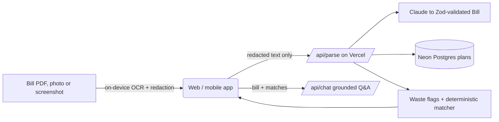
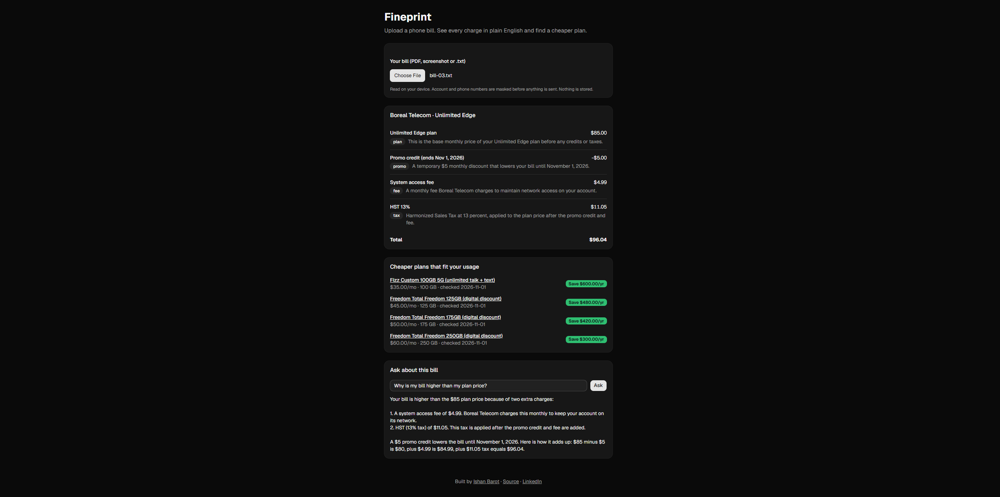
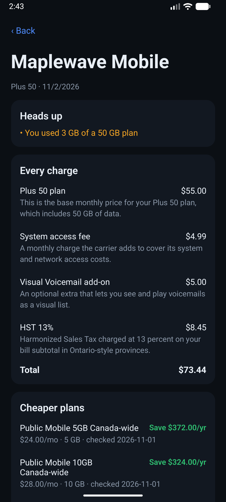

# Fineprint


Upload or snap a phone bill. Fineprint explains every charge in plain English, flags waste (expiring promos, unused data, overages), and finds a cheaper Canadian plan. Web and Android/iOS from one TypeScript codebase.

**Live:** https://fineprint-flame.vercel.app


## What it does
- **Decode:** every line item gets a category tag and a one-sentence explanation.
- **Flag waste:** promo ending soon, using under 25% of your data, overage charges.
- **Match plans:** compares your usage against hand-verified public plans and shows yearly savings.
- **Ask about your bill:** a chat grounded only on your parsed bill and matched plans. Off-topic questions are refused.
- **Mobile:** snap a paper bill with the camera or pick a screenshot. Past bills are saved on the phone only.

## Architecture


Turborepo monorepo:
| Package | What's in it |
| --- | --- |
| `packages/core` | Zod schemas, redaction, waste flags, plan matcher, Claude extraction, design tokens, eval suite |
| `apps/web` | Next.js 16, Tailwind, shadcn/ui, pdf.js + Tesseract for on-device text |
| `apps/mobile` | Expo (React Native), ML Kit on-device OCR, local bill history |

## Where AI is used, and where it isn't
- **Claude extracts** line items into a Zod schema. If validation fails, it retries once with the error fed back, then falls back to manual entry.
- **Plan ranking is plain code**, not AI. Comparing prices is math with a right answer.
- **The chat** only sees the parsed bill and matched plans, answers in plain text, and refuses anything else.
- **Model choice was measured:** Haiku and Sonnet both scored 100% on the eval suite, so Haiku is the default (cheaper, faster).

## Privacy
- Bills are read **on the device** (pdf.js, Tesseract, ML Kit). The original file never leaves it.
- Account numbers, phone numbers, emails and postal codes are masked before any text is sent, and masked again on the server.
- Nothing about the bill is stored. The database only keeps anonymous counts.

## Quality
| Layer | Tool | Status |
| --- | --- | --- |
| Unit | Vitest | 14 tests, 100% line coverage on `packages/core` |
| AI eval | custom suite | 50 synthetic bills, 100% field-level accuracy, runs in CI on AI changes |
| Web E2E | Playwright | upload, results, manual fallback |
| Accessibility | axe-core | WCAG 2 A/AA checks in E2E (it caught a real contrast bug) |
| Mobile E2E | Maestro | onboarding to decode to history flow on Android |
| CI | GitHub Actions | lint, typecheck, tests, e2e on every PR, protected `main`, Vercel previews |

## Screenshots
| Web | Mobile |
| --- | --- |
|  |  |

## Run it locally
```bash
pnpm install
# apps/web/.env.local needs DATABASE_URL and ANTHROPIC_API_KEY
pnpm --filter web dev          # web on localhost:3000
pnpm --filter mobile start     # mobile via Expo
pnpm test                      # unit tests
pnpm eval                      # AI eval suite (needs ANTHROPIC_API_KEY)
```

## What's next
- Harder eval set: OCR noise, French bills, messy layouts
- Multi-month history for repeat-overage detection
- Automated plan price checks

Built by [Ishan Barot](https://www.linkedin.com/in/ishan-b-6a7418284/).